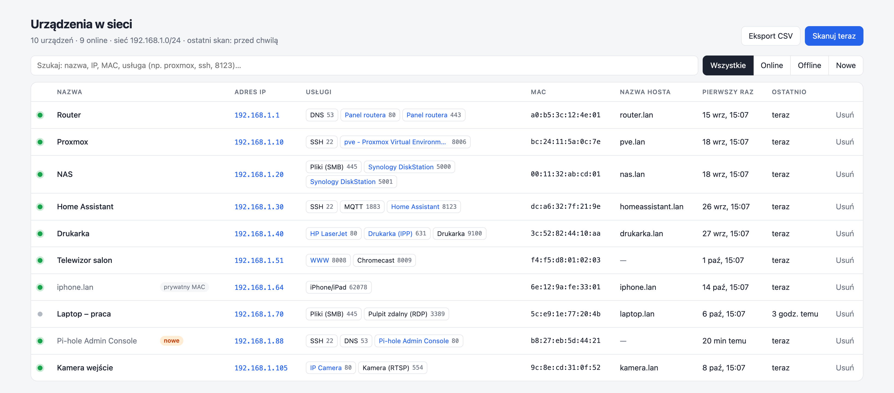
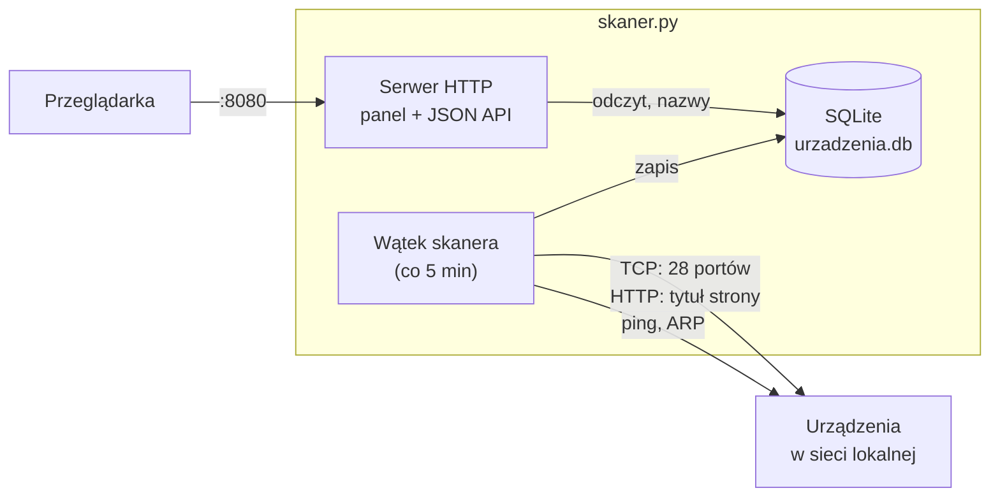

# Skaner sieci domowej

[](https://github.com/lu0i/siec-ip/actions/workflows/exe.yml)


[](LICENSE)

Lekka aplikacja do inwentaryzacji sieci domowej. Co kilka minut wyszukuje wszystkie urządzenia w sieci lokalnej, zapamiętuje ich adresy IP i MAC, rozpoznaje uruchomione na nich usługi i pokazuje wszystko w przejrzystym panelu w przeglądarce.

Odpowiada na pytania w rodzaju: *jaki adres ma drukarka?*, *pod jakim IP jest panel Proxmoxa?*, *co to za nowe urządzenie w moim Wi-Fi?*

> **English summary** — A self-hosted home network inventory tool. It periodically discovers devices on your LAN (ping sweep + ARP), tracks them by MAC address with IP history, detects common services (SSH, web panels, Proxmox, Home Assistant, Plex, printers, …) including web page titles, and serves a searchable web dashboard. Single Python file, standard library only, runs on Linux, macOS and Windows (a standalone `.exe` is provided). The UI and docs are in Polish.

<picture>
  <source media="(prefers-color-scheme: dark)" srcset="docs/panel-dark.png">
  
</picture>

<sub>Zrzut ekranu przedstawia przykładowe, fikcyjne dane.</sub>

## Funkcje

- **Wykrywanie urządzeń** — przeszukuje całą podsieć (ping + tablica ARP), więc znajduje także urządzenia, które nie odpowiadają na ping, np. telefony.
- **Identyfikacja po adresie MAC** — gdy router (DHCP) przydzieli urządzeniu inny adres, to nadal ten sam wpis; poprzednie adresy trafiają do historii.
- **Rozpoznawanie usług** — sprawdza 28 popularnych portów i odczytuje tytuły paneli WWW („Proxmox Virtual Environment”, „Home Assistant”, „Synology DiskStation”…). Panele otwierają się jednym kliknięciem.
- **Wyszukiwarka** — po nazwie, adresie IP, MAC, nazwie hosta, usłudze lub numerze portu.
- **Własne nazwy** — „Telewizor salon” zamiast `f4:f5:d8:01:02:03`.
- **Nowe urządzenia** — oznaczenie wszystkiego, co pojawiło się w sieci w ciągu ostatniej doby, oraz urządzeń z losowym („prywatnym”) adresem MAC.
- **Status online/offline**, data pierwszego i ostatniego wykrycia, **eksport do CSV** (gotowy dla Excela).
- **Zero zależności** — jeden plik Pythona i biblioteka standardowa. Dla Windows gotowy plik `SkanerSieci.exe`.
- **Prywatność** — działa wyłącznie w sieci lokalnej: bez kont, chmury i telemetrii.

## Szybki start

| Gdzie | Jak |
|---|---|
| Windows | Pobierz `SkanerSieci.exe` z [Releases](https://github.com/lu0i/siec-ip/releases/latest) i uruchom dwuklikiem. |
| Linux / macOS | `python3 skaner.py`, potem otwórz `http://localhost:8080`. |
| Serwer Linux | [usługa systemd](#serwer-z-linuksem-systemd) — startuje razem z systemem. |
| Proxmox VE | [skrypt](#proxmox-ve-kontener-lxc), który tworzy osobny kontener LXC. |
| Docker | `docker compose up -d --build` ([szczegóły](#docker)). |

Panel jest dostępny pod adresem `http://<adres-komputera>:8080` z każdego urządzenia w sieci domowej. Pierwszy skan rusza od razu po uruchomieniu, kolejne co 5 minut.

## Instalacja

### Windows — plik .exe

1. Pobierz `SkanerSieci.exe` z [najnowszego wydania](https://github.com/lu0i/siec-ip/releases/latest) i umieść go w osobnym folderze, np. `C:\SkanerSieci` — obok pliku powstanie baza `urzadzenia.db`.
2. Uruchom go dwuklikiem. Otworzy się okno skanera, a panel sam otworzy się w przeglądarce.
3. Plik nie ma płatnego podpisu cyfrowego, więc Windows SmartScreen wyświetli ostrzeżenie: **Więcej informacji → Uruchom mimo to**. Sumę kontrolną SHA-256 znajdziesz w opisie wydania, a sam plik jest budowany publicznie z kodu źródłowego przez [GitHub Actions](.github/workflows/exe.yml).
4. Gdy Zapora Windows zapyta o dostęp, wybierz **Sieci prywatne → Zezwalaj**, aby panel był dostępny z innych urządzeń w domu.

Okno skanera musi pozostać otwarte. Autostart: skrót do `SkanerSieci.exe` w folderze `shell:startup` (`Win+R`).

### Windows — z Pythonem

Zainstaluj Pythona z [python.org](https://www.python.org/downloads/windows/) (zaznacz *Add python.exe to PATH*), pobierz repozytorium i uruchom `start.bat`.

### macOS / Linux

```bash
git clone https://github.com/lu0i/siec-ip.git
cd siec-ip
python3 skaner.py
```

Na macOS możesz też uruchomić `start.command` dwuklikiem w Finderze. Jednorazowy skan z wynikiem w terminalu: `python3 skaner.py --once`.

### Serwer z Linuksem (systemd)

Wystarczy Python 3.8+ (Debian, Ubuntu, Raspberry Pi OS i inne).

```bash
git clone https://github.com/lu0i/siec-ip.git
sudo mkdir -p /opt/siec-ip
sudo cp siec-ip/skaner.py /opt/siec-ip/
sudo cp siec-ip/siec-ip.service /etc/systemd/system/
sudo systemctl daemon-reload
sudo systemctl enable --now siec-ip
```

Usługa działa na dynamicznym, nieuprzywilejowanym koncie systemowym z jednym dodatkowym uprawnieniem (`CAP_NET_RAW` — potrzebnym do pinga). Baza: `/var/lib/siec-ip/urzadzenia.db`, logi: `journalctl -u siec-ip -f`.

### Proxmox VE (kontener LXC)

Skrypt tworzy mały, nieuprzywilejowany kontener z Debianem (256 MB RAM, 2 GB dysku), podłączony do mostka `vmbr0`, i instaluje w nim skaner jako usługę. Na samym hoście nic się nie instaluje. W powłoce Proxmoxa (węzeł → **Shell**):

```bash
cd /root && curl -fsSL https://github.com/lu0i/siec-ip/archive/refs/heads/main.tar.gz | tar xz
bash /root/siec-ip-main/proxmox-lxc.sh
```

Na końcu skrypt wypisze adres panelu. Ponowne uruchomienie aktualizuje skaner w istniejącym kontenerze — baza zostaje.

- stały adres zamiast DHCP: `IP=192.168.1.50/24 GW=192.168.1.1 bash /root/siec-ip-main/proxmox-lxc.sh`
- inny mostek lub magazyn: `BRIDGE=vmbr1 STORAGE=local-zfs bash /root/siec-ip-main/proxmox-lxc.sh`

### Docker

Na hoście z Linuksem:

```bash
docker compose up -d --build
```

`network_mode: host` jest wymagane — inaczej kontener widzi tylko własną sieć wirtualną. Baza: `./dane/urzadzenia.db`. Na Docker Desktop (macOS/Windows) tryb host nie daje dostępu do sieci domowej — tam uruchom skaner bezpośrednio.

## Korzystanie z panelu

- **Kropka** — zielona: urządzenie odpowiedziało w ostatnim skanie; szara: offline.
- **Nazwa** — kliknij i wpisz własną; Enter zapisuje.
- **Adres IP** — kliknij, aby zobaczyć historię adresów urządzenia.
- **Usługi** — niebieskie etykiety to panele WWW; kliknięcie otwiera je w nowej karcie.
- **Filtry** — wszystkie, online, offline, nowe (z ostatnich 24 h).
- **Wyszukiwarka** — np. `proxmox`, `home assistant`, `ssh`, `drukarka`, `8123`.
- **Eksport CSV** — plik rozdzielany średnikami, z kodowaniem UTF-8 (otwiera się od razu w kolumnach Excela).

### Wykrywane usługi

| Port | Usługa | Port | Usługa |
|---|---|---|---|
| 21 | FTP | 8000, 8008 | strona WWW |
| 22 | SSH | 8006 | Proxmox VE |
| 53 | DNS (router, Pi-hole) | 8009 | Chromecast |
| 80, 443 | strona WWW (router, NAS, kamera…) | 8080, 8443 | strona WWW |
| 445 | udostępnianie plików (SMB) | 8096 | Jellyfin |
| 554 | kamera (RTSP) | 8123 | Home Assistant |
| 631 | drukarka (IPP) | 9000, 9443 | strona WWW (np. Portainer) |
| 1883 | MQTT | 9100 | drukarka (RAW) |
| 3000 | strona WWW (np. Grafana) | 32400 | Plex |
| 3389 | pulpit zdalny (RDP) | 62078 | iPhone / iPad |
| 5000, 5001 | strona WWW (np. Synology) | 5900 | VNC |
| 7000 | AirPlay | | |

Listę rozszerzysz w słowniku `SERVICES` na początku `skaner.py`.

## Opcje

| Opcja | Domyślnie | Opis |
|---|---|---|
| `--subnet 192.168.1.0/24` | wykrywana automatycznie | skanowana sieć (automatycznie: sieć aktywnego interfejsu, maks. 4096 adresów) |
| `--interval 300` | 300 s | odstęp między skanami |
| `--port 8080` | 8080 | port panelu WWW |
| `--host 127.0.0.1` | `0.0.0.0` | adres nasłuchu; `127.0.0.1` ogranicza panel do tego komputera |
| `--allow-host NAZWA` | — | dodatkowa nazwa domenowa panelu (adresy IP i nazwy `.lan`, `.local`, `.home.arpa` działają bez tego) |
| `--db PLIK` | `urzadzenia.db` obok programu | plik bazy danych |
| `--once` | — | jeden skan, wynik w terminalu, koniec |
| `--no-browser` | — | `.exe` nie otwiera przeglądarki po starcie |

## Jak to działa



Każdy skan przebiega w czterech krokach:

1. **Odkrywanie** — równoległy ping (128 wątków) do każdego adresu w podsieci. Każda próba wymusza zapytanie ARP, więc po chwili tablica ARP systemu zawiera także urządzenia ignorujące ping.
2. **Identyfikacja** — z tablicy ARP (`ip neigh` na Linuksie, `arp -a` na macOS i Windows) brane są pary IP–MAC. Na Linuksie uwzględniany jest stan wpisu, dzięki czemu wyłączone urządzenia nie są liczone jako online.
3. **Usługi i nazwy** — połączenie TCP z każdym portem z listy (limit 0,6 s), odczyt tytułu strony z portów WWW (maks. 64 kB, przekierowania tylko w obrębie tego samego urządzenia) i odwrotne zapytanie DNS o nazwę hosta.
4. **Zapis** — jedna transakcja SQLite: aktualizacja statusów, historii adresów i listy usług.

### Budowa

Cała aplikacja to jeden plik [`skaner.py`](skaner.py) korzystający wyłącznie z biblioteki standardowej Pythona:

| Warstwa | Implementacja |
|---|---|
| Skanowanie | `subprocess` (ping, `ip`/`arp`/`ipconfig`), `socket`, `concurrent.futures`, `urllib` |
| Dane | `sqlite3` — tabele `devices`, `ip_history`, `services`, `scans` |
| Serwer | `http.server.ThreadingHTTPServer` + JSON API |
| Interfejs | jedna strona HTML z CSS i JavaScriptem osadzonymi w pliku — bez frameworków i zewnętrznych zasobów, z trybem jasnym i ciemnym |
| Dystrybucja | PyInstaller (`.exe`), systemd, LXC, Docker |

JSON API (używane przez panel, przydatne do własnych integracji):

| Metoda | Ścieżka | Działanie |
|---|---|---|
| `GET` | `/api/devices` | lista urządzeń z usługami i stan skanera |
| `GET` | `/api/devices.csv` | eksport CSV |
| `GET` | `/api/devices/{mac}/history` | historia adresów IP |
| `POST` | `/api/devices/{mac}` | zmiana nazwy — `{"name": "…"}` |
| `DELETE` | `/api/devices/{mac}` | usunięcie wpisu |
| `POST` | `/api/scan` | natychmiastowy skan |

Żądania `POST` wymagają nagłówka `Content-Type: application/json`.

### Struktura repozytorium

```
siec-ip/
├── skaner.py                   # cała aplikacja: skaner, baza, API, panel WWW
├── start.command               # uruchomienie na macOS (dwuklik)
├── start.bat                   # uruchomienie na Windows z Pythonem (dwuklik)
├── siec-ip.service             # usługa systemd
├── proxmox-lxc.sh              # instalator kontenera LXC na Proxmox VE
├── Dockerfile
├── docker-compose.yml
├── docs/                       # zrzuty ekranu (dane przykładowe)
└── .github/workflows/exe.yml   # budowa i test SkanerSieci.exe na Windows
```

## Bezpieczeństwo i prywatność

- **Panel nie ma logowania** — jest przeznaczony do zaufanej sieci domowej. Nie przekierowuj jego portu na routerze do internetu; do zdalnego dostępu użyj VPN (np. WireGuard). Opcja `--host 127.0.0.1` ogranicza panel do jednego komputera.
- Panel odrzuca żądania z obcych domen (ochrona przed *DNS rebinding*), zmiany danych wymagają żądań JSON (ochrona przed CSRF), a odpowiedzi mają nagłówki CSP i `X-Frame-Options`.
- Aplikacja **nie łączy się z internetem**: brak telemetrii, kont i sprawdzania aktualizacji. Ruch sieciowy obejmuje wyłącznie urządzenia w skanowanej sieci oraz zapytania DNS do serwera skonfigurowanego w systemie (zwykle routera).
- Baza `urzadzenia.db` to mapa Twojej sieci — traktuj ją jak dane prywatne. Jest wykluczona z repozytorium w `.gitignore`.

Szczegóły, model zagrożeń i zgłaszanie podatności: [SECURITY.md](SECURITY.md).

## Odpowiedzialne użycie

Skaner aktywnie sprawdza urządzenia (ping, połączenia TCP z wybranymi portami, odczyt stron WWW). Używaj go wyłącznie w sieciach, które należą do Ciebie lub którymi administrujesz. Skanowanie cudzych sieci bez zgody może naruszać prawo i regulaminy dostawców.

## Ograniczenia

- Widoczna jest tylko sieć, do której należy komputer ze skanerem; inne podsieci (np. sieć gości) wymagają `--subnet` i trasy do tej sieci.
- Na macOS i Windows wyłączone urządzenie może jeszcze przez kilka–kilkanaście minut figurować jako online (czas życia wpisów ARP w systemie). Na Linuksie status aktualizuje się przy najbliższym skanie.
- Telefony z losowym adresem MAC mogą po pewnym czasie pojawić się jako nowe urządzenie.
- Nazwy hostów pojawiają się tylko wtedy, gdy udostępnia je lokalny DNS (zwykle router).
- Usługi na niestandardowych portach lub za zaporą urządzenia nie zostaną wykryte.
- Obsługiwane jest tylko IPv4.

## Budowanie pliku .exe

Plik `SkanerSieci.exe` budowany jest automatycznie przez [GitHub Actions](.github/workflows/exe.yml) na Windows przy każdej zmianie w gałęzi `main`. Po zbudowaniu workflow uruchamia skan i panel, aby sprawdzić, czy program działa. Ręcznie (na Windows):

```bash
pip install pyinstaller
pyinstaller --onefile --console --name SkanerSieci skaner.py
```

## Licencja

[MIT](LICENSE)
